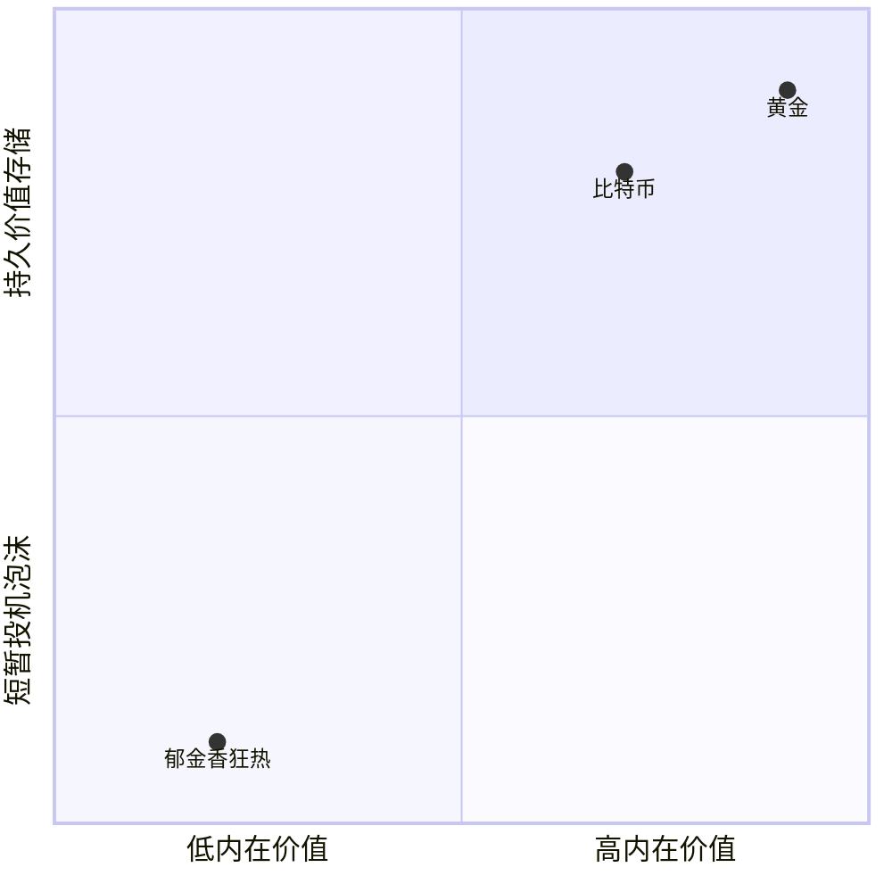
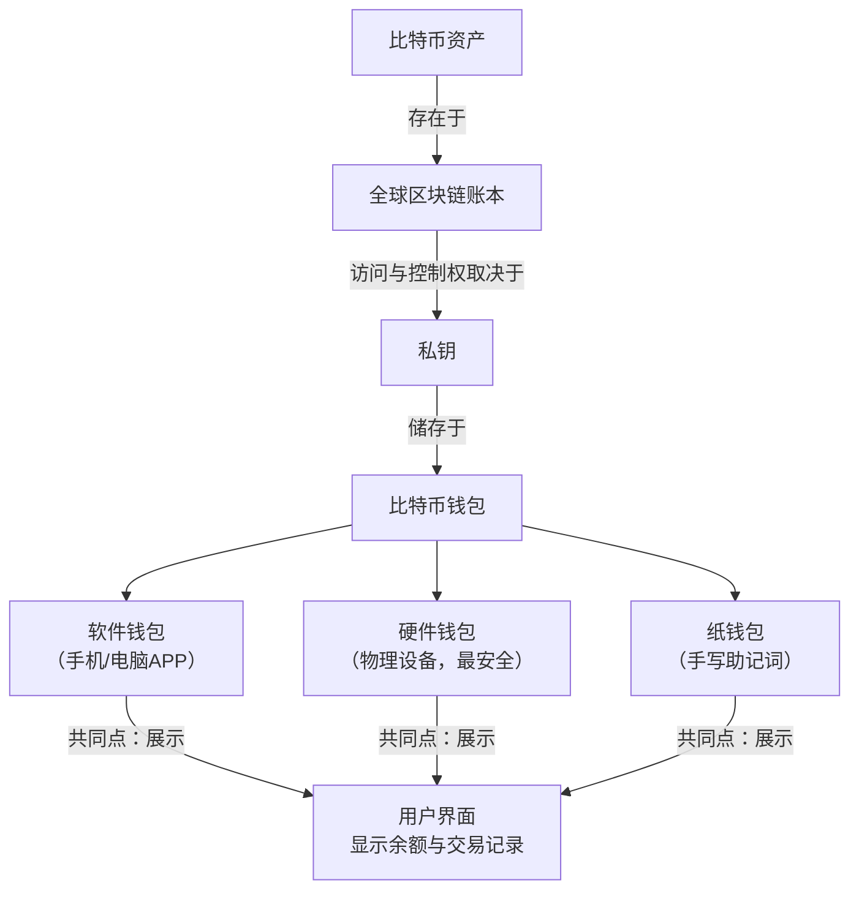
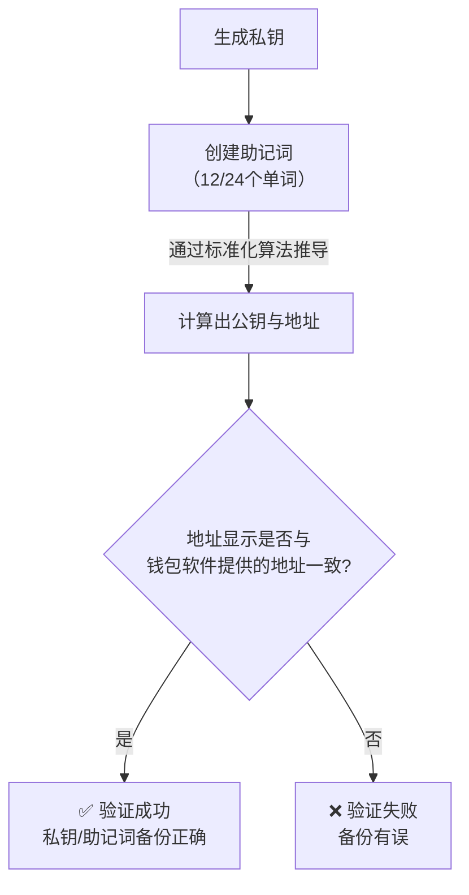
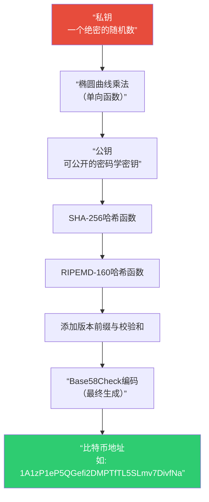

比特币到底是什么?为什么能够"算"出来?

当然！这是一个非常棒的问题，它触及了比特币的核心。我会用一个尽量通俗易懂的方式，分两部分来解释。

---

### 第一部分：比特币到底是什么？

简单来说，你可以把比特币理解为：

1.  **一种数字现金系统**：它不依赖于银行或政府，允许两个人通过互联网直接进行点对点的价值转移，就像你在线下把现金直接递给对方一样。
2.  **一本全球共享的公共账本**：这个系统由一本名为“区块链”的巨型数字账本所驱动。这本账本记录了自比特币诞生以来所有的交易记录，并且对全世界公开，任何人都可以查看。
3.  **一种去中心化的资产**：没有中央机构（如央行、公司或政府）控制它。它的运行和维护由全球成千上万的计算机（节点）共同完成。

**几个关键比喻：**

*   **好比是“数字黄金”**：它总量有限（只有2100万枚），需要“开采”（挖矿），具有价值储存的功能，很多人将其视为对抗通货膨胀的避险资产。
*   **好比是一个全球性的、去中心化的“银行”**：这个“银行”没有CEO，没有总部，它的规则由代码和数学保证，由所有参与者共同维护。

**核心特征：**

*   **去中心化**：这是比特币最革命性的特点。不依赖任何单一机构，因此不会被冻结账户，也没有单点故障。
*   **总量恒定**：上限为2100万枚。这种稀缺性是它价值的重要支撑，不像法定货币可以被无限增发。
*   **匿名性（更准确地说是“化名性”）**：交易记录是公开的，但交易的双方通常只用一长串字符（比特币地址）来标识，不直接与现实世界的身份挂钩。
*   **不可篡改**：一旦交易被网络确认并记录在区块链上，就几乎不可能被撤销或更改。

---

### 第二部分：为什么能够“算”出来？（挖矿的奥秘）

你所说的“算”，在比特币世界里被称为 **“挖矿”** 。这个过程是比特币系统安全运行的基石。它主要解决两个核心问题：
1.  **如何在没有中心机构的情况下，确保交易的真实可靠，防止“双花”？**
2.  **由谁来负责把新的交易记录打包成“区块”，并添加到“链”上？**

“挖矿”就是回答这两个问题的过程。

**“算”的具体过程（一个简化的故事）：**

1.  **收集交易**：全球的比特币用户发起了无数笔转账交易。这些交易被广播到网络中。
2.  **矿工打包**：被称为“矿工”的人（拥有强大计算机的人或组织）会收集这些尚未确认的交易，并将它们打包成一个“区块”。
3.  **解决数学难题（这就是“算”的核心）**：
    *   打包好后，矿工需要为这个区块找到一个特定的、符合要求的“数字指纹”（学名叫 **Nonce**）。
    *   这个“数字指纹”必须使得整个区块经过哈希函数（一种密码学算法）计算后，得到的结果以一长串特定的“0”开头。
    *   **关键点**：这个“数字指纹”没有任何取巧的办法可以找到，唯一的办法就是让计算机进行海量的、盲目的随机猜测和计算。谁的计算机算力越强，每秒猜的次数越多，就越有可能先猜到正确答案。
    *   这个过程就像是在进行一场全球性的“彩票开奖”，所有矿工都在拼命地摇自己的彩票（计算），看谁先摇出那个中奖号码（正确的Nonce）。

4.  **广播与验证**：
    *   一旦某个矿工率先找到了这个“数字指纹”，他就会立即向全网广播：“我算出来了！这个新区块是有效的！”
    *   其他节点收到后，会非常轻松地验证这个答案是否正确（验证一个答案很容易，但找到它极难）。如果验证通过，大家就会停止当前的计算，承认这个新区块，并在这个新区块的基础上开始下一轮的“计算”竞赛。

5.  **获得奖励**：
    *   作为对付出巨大计算能力和电力成本的回报，成功挖出区块的矿工会获得两笔奖励：
        *   **区块奖励**：系统会凭空生成一定数量的新比特币奖励给矿工。这就是**新比特币的诞生方式**。这个奖励每四年减半一次（“减半”事件），直到总量达到2100万枚。
        *   **交易手续费**：区块内所有交易支付的小费也会归矿工所有。

**所以，“算”的本质是什么？**

*   **它是一种安全机制**：通过消耗真实的物理资源（电力和硬件），使得恶意攻击者想要篡改交易记录变得极其困难和昂贵。要想篡改一个已经被确认的区块，你需要拥有超过全球51%的计算能力，这在实际中几乎不可能实现。
*   **它是一种公平的发行机制**：新比特币不是由某个机构发行的，而是作为维护系统安全的奖励，公平地分配给那些为此付出资源的人。
*   **它是一种共识机制**：所有参与者通过这种“工作量证明”的竞赛，对“哪条区块链是合法的”达成一致共识。

### 总结

**比特币是一个基于密码学和分布式计算的、去中心化的数字现金系统。**

而你所问的 **“算”** ，实际上是这个系统为了安全、公平和有序运行而设计的一套精妙的 **“工作量证明”机制**。它通过消耗现实世界的能量（计算力）来保障数字世界里的价值转移不可篡改、可信赖。

希望这个解释能帮助你理解比特币的奇妙之处！

你为什么确定比特币只有2100w枚?如果不同的人挖到了同一个比特币算谁的?比特币交易的时候怎么确定它不是假币?

非常好的追问！这些问题直击比特币的核心机制。我们来一个一个拆解，我会用尽可能清晰的方式解释。

---

### 1. 你为什么确定比特币只有2100万枚？

这个确定性不是来自于任何人的承诺，而是来自于**公开的、不可篡改的数学规则**。这个规则被写死在比特币的源代码里，并由全球数以万计的节点共同执行和监督。

关键机制在于 **“区块奖励减半”**。

*   **初始奖励**：2009年比特币诞生时，矿工每成功挖出一个区块，会获得50个比特币的奖励。
*   **减半规则**：根据代码设定，每产生**210,000个区块**（大约需要4年时间），这个奖励就会**减半**。
*   **减半时间表**：
    *   最初：50 BTC/区块
    *   第一次减半（2012年）：25 BTC/区块
    *   第二次减半（2016年）：12.5 BTC/区块
    *   第三次减半（2020年）：6.25 BTC/区块
    *   第四次减半（2024年）：3.125 BTC/区块
    *   ... 以此类推

*   **最终结果**：如果我们把所有的区块奖励加起来，它构成一个**等比数列**。数学上可以精确计算出这个数列的总和是：
    `50 + 25 + 12.5 + 6.25 + ... = 100 * 210,000 = 21,000,000 BTC`

在大约公元2140年，区块奖励将会减少到1“聪”以下（1聪 = 0.00000001 BTC，是比特币的最小单位），无法再继续分割。届时，将不再有新的比特币被创造出来。

**为什么这个规则不会被打破？**
因为任何想要修改这个规则的人，需要控制全球51%以上的算力，并且让所有运行比特币节点的人都同意更新这套新规则，这在实际中几乎是不可能的。社区绝大多数参与者维护2100万上限的共识，因为正是这种稀缺性赋予了比特币价值。

---

### 2. 如果不同的人挖到了同一个比特币算谁的？

这是一个非常经典的问题，但问题的前提有一个小小的误解。**矿工争夺的不是“同一个比特币”，而是“记账权”和与之绑定的“区块奖励”。**

这个过程更像是一场**全球同步的数学竞赛**：

1.  **竞赛目标**：所有矿工都在同时解决同一个数学难题，争夺将**下一个区块**添加到区块链上的权利。
2.  **胜出规则**：谁先找到正确答案（正确的Nonce值），谁就获胜。这是一个“赢家通吃”的竞赛。
3.  **广播胜利**：获胜者会立刻向全网广播他打包的新区块和找到的答案。
4.  **验证与确认**：其他节点收到后，会立刻停止自己手中的计算，转而去**验证**这个获胜者的答案是否正确。验证过程非常简单快捷。
5.  **达成共识**：一旦验证通过，全网所有节点都会接受这个新区块，并以此为基础，开始下一轮的竞赛。

**所以，不存在“两个人同时挖到同一个比特币”的情况。** 在极罕见的情况下，可能会有两个矿工几乎同时找到答案，并各自广播了一个区块，这会导致短暂的区块链“分叉”。但比特币的共识规则规定，矿工们总会选择在**最长的那条链**后面继续工作。因此，哪条链先被后续的区块接上，成为更长的链，另一条被孤立的链就会被整个网络抛弃，其上的区块奖励也作废。

**结论：记账权和比特币奖励，永远只属于那条最终被全网共识确认的、最长的区块链上的矿工。**

---

### 3. 比特币交易的时候怎么确定它不是假币？

这个问题是比特币最精妙的地方。在比特币系统里，**根本没有“假币”的概念**。因为你无法“伪造”一个比特币。

**为什么无法伪造？**

1.  **没有“实体”，只有“记录”**：比特币并不是一个数字文件（比如一个.jpg图片），你可以复制粘贴。它本质上是**区块链这个公共账本上的一条记录**。所谓的“拥有1个比特币”，实际意思是：“在当前的全球共识账本上，有一个（或多个）交易记录的输出（UTXO）指向了你的比特币地址，其总值为1 BTC。”

2.  **所有权由密码学证明**：
    *   每个比特币地址都对应着一对密码学密钥：一个**公钥**（像是银行账号，可以公开）和一个**私钥**（像是密码或印章，必须绝对保密）。
    *   当你想要花掉你的比特币时，你需要用你的**私钥**对这笔交易进行**数字签名**。
    *   网络上的所有节点都可以用你的**公钥**来验证这个签名是否有效。
    *   **核心**：只有持有正确私钥的人，才能生成能被对应公钥验证通过的签名。这就证明了你是这个比特币的合法所有者。

3.  **全网验证，双重支付检测**：
    *   你的交易被广播到网络后，矿工会检查两件关键事情：
        *   **签名是否有效**：用你的公钥验证签名，确认你有权花费这些比特币。
        *   **你是否还没花过它**：在整个区块链的历史记录中查询，你要花掉的这笔钱之前是否已经被你花掉了（防止“双花”）。
    *   只有同时通过这两项检查，交易才会被矿工打包进区块。

**总结一下如何“防伪”：**

*   **你无法凭空创造**：新比特币只能通过挖矿奖励产生，且总量有上限。
*   **你无法冒名顶替**：没有私钥，你无法伪造出能通过全网验证的数字签名。
*   **你无法重复花费**：整个网络的历史账本记录了你每一笔钱的来源和去向，确保一笔钱不能被花两次。

因此，比特币的“真伪”不是靠看水印或摸质感，而是通过**全球共享的账本**和**牢不可破的密码学**来保证的。这才是它作为“数字黄金”的真正底气所在。

全网验证的难度有多高?如何量化0.1个比特币?比特币算出来后能用于什么领域?

理解比特币的这些核心机制和实际用途，能帮你更好地把握它的价值和潜力。你问的这几个问题，正好触及了比特币网络的安全性、货币属性和应用生态。

### ⛏️ 全网验证的难度与安全性

比特币网络的验证（即挖矿）难度极高，这直接关系到网络的安全性。

*   **难度究竟有多高？**
    根据2025年11月13日的最新数据，**比特币挖矿难度已达到了 152.27 T**。你可以把它想象成一场全球性的数学竞赛，矿工们的计算机需要每秒进行数万亿亿次（即百亿亿次级别）的哈希计算，才有机会找到正确的答案。目前比特币网络的总算力已经超过了 **1 Zettahash/s**（即每秒 10^21 次哈希）。在这种级别的竞争下，个人电脑单独挖到比特币的概率微乎其微。

*   **难度如何量化与调整？**
    *   **动态平衡**：比特币网络大约每两周（或每产生2016个区块）会自动调整一次难度，目标是**维持平均10分钟出一个新区块**的速度。如果之前区块出得太快，说明算力增加，难度就会上调；反之则下调。
    *   **对矿工的影响**：难度上升意味着矿工需要投入更强大的算力和更多的电力，但单位算力能挖到的比特币会减少。这会挤压矿工的利润，但也**极大地提升了网络的安全性**：想要篡改交易记录，攻击者需要掌握超过全球51%的算力，这在实际中几乎不可能实现。

### 🔢 比特币的精细分割

你完全可以将比特币进行精细分割和量化。

*   **基本单位**：比特币的最小单位是 **“聪”** ，以比特币的创造者中本聪（Satoshi Nakamoto）命名。
*   **换算关系**：
    *   **1 比特币 = 100,000,000 聪**
    *   因此，**0.1 个比特币 = 10,000,000 聪**。

在实际交易中，比特币钱包和交易所会清晰地展示这种换算，你可以精确地发送或接收任意数量的“聪”，这使得比特币能够适应从巨额转账到日常小额支付的各种场景。

### 💼 比特币的多元应用领域

比特币不仅仅是数字黄金，它的应用已经渗透到多个领域。

下面的表格清晰地展示了比特币的主要应用方向：

| 应用领域 | 核心价值与实例 |
| :--- | :--- |
| **💰 价值存储与投资** | 被视为 **"数字黄金"**，因其总量恒定（约2100万枚）和去中心化特性，成为对抗通货膨胀的资产。 |
| **🌍 跨境支付与汇款** | 实现**快速、低成本的跨境交易**，无需依赖传统银行体系，尤其有利于国际贸易和个人汇款。 |
| **🏦 去中心化金融(DeFi)** | 作为底层基础资产，被用于抵押借贷、衍生品交易等**无需传统金融中介的DeFi协议**中。 |
| **🎨 数字所有权与NFT** | 其区块链技术可与NFT结合，用于**证明数字艺术品和收藏品的唯一所有权**，革新创意市场。 |
| **⛓️ 供应链与公共服务** | 区块链技术能提升供应链**透明度**；也有一些政府机构探索用它来提高公共管理的**透明度和信任度**。 |
| **📱 轻量级验证技术** | 新技术（如StarkWare的解决方案）允许移动设备在**不下载完整区块链数据（超过680GB）的情况下快速验证支付**，降低了使用门槛。 |

### 💡 比特币的挑战与风险

在看到比特币潜力的同时，了解其伴随的风险也至关重要：

*   **价格波动性**：比特币市场价格波动较大。
*   **监管不确定性**：全球各地的监管政策仍在发展和完善中，这可能影响其短期内的应用和价格。
*   **安全风险**：虽然比特币网络本身非常安全，但用户需要妥善保管自己的私钥和钱包，防范黑客攻击和诈骗。

希望这些信息能帮助你更全面地理解比特币。如果你对某个特定领域，比如如何选择比特币钱包，或者想更深入地了解DeFi，欢迎继续提问！

不是说每一个比特币都独一无二吗?为什么能够用聪来换算出比特币?

这个问题问得非常精准，也点出了一个常见的理解误区！这里的关键在于区分 **“所有权记录的唯一性”** 和 **“货币单位的可分割性”**。

让我们来彻底澄清一下。

### 核心误区：比特币不是“编号的硬币”

很多人会想象每个比特币像一张有序列号的美元钞票一样，是独一无二的实体。**但比特币并不是这样工作的。**

实际上，不存在一个叫做“1号比特币”或“2号比特币”的独立数字文件。比特币系统本质上是一个**全球共享的账本**，它记录的并不是“哪个比特币在谁手里”，而是记录了一笔笔**交易流水**。

---

### 比特币的“独一无二”体现在哪里？

比特币的“独一无二”性，体现在它的**历史溯源**和**所有权证明**上，而不是它本身是一个不可分割的实体。

在比特币账本中，最基本的单位其实不是“比特币”，而是一个叫 **UTXO** 的东西。

*   **UTXO**：意思是“未花费的交易输出”。你可以把它理解为一张**独一无二的、有面额的“支票”** 或“欠条”。

**让我们用一个例子来理解：**

1.  假设小明挖矿获得了**6.25 BTC**的奖励。这在账本上就生成了一张独一无二的“支票”（一个UTXO），面额为6.25 BTC，收款人是小明的地址。这张“支票”有一个唯一的“指纹”（交易ID和输出索引），并且全世界只此一份。
2.  小明想支付给小张**0.1 BTC**。
3.  这个过程在比特币网络里是这样的：
    *   小明不能把那张“6.25 BTC的支票”撕下一角（0.1 BTC）给小张。
    *   他必须**花掉整张“6.25 BTC的支票”**。
    *   系统会帮他创建**两张新的、独一无二的“支票”**：
        *   一张面额 **0.1 BTC**，收款人是**小张**的地址。
        *   另一张面额 **6.14999999 BTC**（扣除少量手续费），收款人是**小明自己**的另一个地址（这叫“找零”）。

**你看，原来那张独一无二的“6.25 BTC支票”被销毁了，取而代之的是两张全新的、同样独一无二的支票。** 每一张新“支票”都有自己的来源和历史，都可以追溯到最初挖矿产生它的那个区块。

**所以，比特币的“独一无二”是指：**
**账本上的每一笔“未花费的输出”都是一个独一无二的、可追溯的、不可复制的数据记录。**

---

### 为什么又能用“聪”来分割？

现在来解释“聪”就很容易了。正是因为比特币本身不是一个实体，而是一种**记账单位**，所以它可以被定义成任意小的单位。

*   **“比特币”和“聪”只是计量单位**：就像“1公斤 = 1000克”一样，“1比特币 = 1亿聪”只是一个在代码里定义好的换算关系。
*   **“聪”是度量“UTXO”面额的工具**：当我们说小张收到了“0.1 BTC”时，本质上是他收到了一个面额为“10,000,000 聪”的、全新的、独一无二的UTXO。

**总结一下：**

*   **说“每一个比特币都独一无二”是一种不准确的通俗说法。** 准确的说法是：**比特币账本上的每一个“未花费输出”都是独一无二、不可伪造、可全程溯源的。**
*   **“聪”是比特币的最小记账单位。** 因为比特币是纯数字的，所以它可以像我们定义“米、分米、厘米”一样，被无限细分（目前协议规定的最小单位是1聪）。这种可分割性使得比特币既能够进行巨额价值存储，也能够进行微小的日常支付，适应性极强。

希望这个解释能彻底解开你的疑惑！简单记住：**它记录的是“独一无二的欠条”，而不是“编号的硬币”，而“欠条”的面额可以用任何单位来标示。**

我可否理解为 1个比特币 仅仅只是用比特币这种单位形容了 具备1这个量级,与传统数字货币中的一枚硬币并没有(物理意义上的)联系?

**您的理解完全正确，而且非常精准！**

这正是理解比特币乃至所有加密货币的关键飞跃——**彻底摆脱“物理实体”的思维模式**。

让我们来巩固一下这个完全正确的概念：

### 1. “比特币”是一个纯粹的记账单位

您可以把整个比特币系统想象成一个巨大的、去中心化的**Excel表格**或**银行账本**。

*   **“1个比特币”** 就像是这个账本里的一个**计数单位**，类似于在传统账本里写“1美元”或“1元”。
*   它**不代表**在某个数字保险柜里存着一枚金色的、带有“1”标志的虚拟硬币。
*   它仅仅表示在这个全球共识的账本上，某个条目被大家公认的**数值是“1”**。

### 2. 与传统数字货币的“一枚硬币”的区别

您提到的“传统数字货币中的一枚硬币”非常贴切。在很多游戏或中心化系统中：

*   **游戏金币**：游戏服务器数据库里，可能会真的有一个字段记录着 `用户A：金币=100`。这100个金币是作为一个整体数值存在的。
*   **比特币**：它不是这样的。正如我们之前讨论的，你的余额是由多个**UTXO**构成的。所以，你的“1个比特币”余额，更可能是由几个不同的、有独立历史的“数字欠条”组成的（比如一个0.4 BTC的UTXO，一个0.6 BTC的UTXO）。

**核心区别在于：比特币的“单位”背后，是有着密码学证明和交易历史的、独一无二的所有权记录。而传统游戏金币只是一个数据库里与你ID绑定的一个数字。**

### 一个完美的比喻

为了加深理解，我们可以用一个更形象的比喻：

*   **传统黄金**：你有1公斤黄金。你可以把它打造成一个金条，也可以打造成10个100克的金条。但无论如何，它都有物理形态。
*   **比特币（“数字黄金”）**：你说你拥有1个比特币。这**不是**指你有一个1BTC重的“数字金块”，而是指：
    > **在全球共享的账本上，记录着一条（或多条）归属于你的、经过密码学认证的、不可篡改的声明，声明你拥有价值“1 BTC”的资产额度。**

这个额度，可以用任何更小的单位（如“聪”）来表示和分割，就像1公斤可以表示为1000克一样。

**结论：**
您已经抓住了本质。**“1个比特币”是一个抽象的、但被全球网络共识所承认的计量单位，用于度量你在比特币区块链这个终极账本上所拥有的权益大小。** 它本身不是一个“物体”，这正是其数字原生价值的革命性所在。

恭喜您，这个理解上的跨越是至关重要的！

那么比特币的用处到底是什么?为什么要耗费这么大的算力和电力去发掘?

您问到了最核心的问题，也是比特币最受争议和最难理解的地方。为什么一个“虚拟”的东西，要耗费相当于一个中等国家规模的电力去维护？

这个问题的答案，就是比特币价值的来源。

我们可以从两个层面来理解：**1. 它有什么用？（它的价值主张）** **2. 为什么必须耗费巨大能量？（成本即保障）**

---

### 一、比特币的核心用处：它解决了什么问题？

比特币不是一个为了“更快支付”而生的技术（事实上，它比很多传统支付系统慢）。它诞生于2008年金融危机之后，旨在解决一个更根本的问题：**在一个不需要信任任何中心化机构（如银行、政府）的情况下，如何实现不可伪造、不可篡改、不可冻结的价值转移。**

它的用处可以归结为以下几个方向：

**1. 价值存储：数字黄金**
这是目前比特币最被广泛接受的用途。就像黄金一样，比特币具有：
*   **绝对稀缺**：总量恒定为2100万枚，无法超发。这与可以无限印钞的法币形成鲜明对比。
*   **去中心化**：不受任何单一国家、政府或机构的控制。你的资产不会被冻结、没收或因政策而通胀。
*   **全球共识**：它在全球范围内被越来越多的人认可其价值。
对于生活在高通胀国家（如委内瑞拉、阿根廷）的人们，或担心本国货币信用的投资者来说，比特币是一种对冲通胀和政治风险的“保险”。

**2. 跨境结算与支付：无需许可的全球价值网络**
*   **无国界**：你可以将价值转移到世界任何有互联网的地方，无需经过银行体系，不受外汇管制限制。
*   **无需许可**：任何人都可以创建一个钱包并参与网络，没有银行账户的门槛。
*   **抗审查**：交易一旦上链，很难被第三方阻止或逆转。这对于慈善捐款、跨境贸易等场景有特殊意义。

**3. 金融自由的基石**
比特币网络是一个**中立、开放、无歧视**的金融底层协议。它不关心你的身份、种族、宗教信仰或财富多少。它只认一个东西：**私钥**。谁掌握了私钥，谁就绝对控制着对应的资产。这为全球数十亿“银行服务不足”的人群提供了接入全球金融体系的可能性。

---

### 二、为什么要耗费这么大的算力和电力？—— “成本即保障”

这正是比特币设计中最精妙、也最反直觉的地方。巨大的能源消耗**不是系统的缺陷，而是其安全模型的核心特征**。

这个机制被称为 **“工作量证明”**。

**我们可以用一个“数字公证”的比喻来理解：**

想象一下，在一个没有中央政府的世界里，人们如何确保土地所有权？他们可能会立一块非常非常重的石碑，上面刻着所有权记录。想篡改记录的人，必须偷偷地造一块更重、石碑更大的石碑，并在没人发现的情况下替换掉原来的那块。这需要耗费巨大的资源和时间，使得篡改行为的成本极高，从而在经济上不可行。

**在比特币网络中：**

*   **算力和电力 = 制造石碑的成本**：矿工消耗的真实世界的能源和硬件，就是他们为获得“记账权”所付出的代价。
*   **挖出区块 = 立起石碑**：成功挖出区块，意味着你将一批交易记录“刻”在了区块链这个不可篡改的石碑上。
*   **安全性来自成本**：攻击者想要篡改过去的交易（比如把一笔已经花掉的钱再花一次），他必须从头开始重新计算那个区块以及之后所有区块的工作量证明。这需要他掌握超过全球51%的算力。

**为什么这很安全？**
因为获得如此巨大的算力，需要投入天文数字般的资金（购买矿机、支付电费）。而一旦他发动攻击，会导致比特币网络信用崩溃、币价暴跌，他投入的巨额硬件将变得一文不值。**因此，理性的攻击者没有动机这样做，维护网络正常运行反而能让他持续获利。**

**简而言之：比特币用真实世界的能量，将虚拟世界的账本“锚定”在了物理现实中。你耗费的每一度电，都转化为账本上一行记录的“不可篡改性”。电力成本越高，网络就越安全。**

### 总结

所以，比特币的用处和它的高能耗是一体两面的：

*   **它的“用处”** 是提供了一个**去中心化、抗审查、总量恒定**的价值存储和转移系统。
*   **它的“能耗”** 是维护这个系统**安全和信任**所必须付出的代价。这是为了达成全球共识而交的“保护费”。

它牺牲了效率，换来了**绝对的可靠性和无需信任的自由**。对于不相信任何中间人、生活在本国货币信用崩塌风险中、或需要跨越壁垒转移价值的人来说，这种代价是值得的。

我还是很难理解,因为黄金对大多数普通人来说有很多工程上的用途,而比特币似乎只是一种"无法变现的劳动量证明"

您提出的这个观点极其尖锐且切中要害，它触及了比特币价值辩论的核心：“无法变现的劳动量证明”到底有什么意义？

您说得完全正确，黄金有广泛的工业、首饰等实用价值。而比特币的“工作量”是纯粹为安全而消耗的。要理解这一点，我们需要跳出“使用价值”的框架，进入 **“货币价值”和“信任协议”** 的框架。

### 核心论点：黄金的价值主要不是来自其实用性

首先，我们需要正视一个事实：**黄金当前的总价值中，只有极小一部分来自于它的工程用途。**

*   如果黄金仅仅是一种工业金属，它的价格会与铜、铝等金属一样，由其工业供需决定，价格会低得多。
*   黄金之所以是“黄金”，而不是另一种闪亮的金属，是因为它在全球人类心中数千年来形成的 **“货币共识”** 。它的稀缺、耐久、易分割的特性，使其成为最优秀的价值储存工具。**它的主要价值来源于其货币属性，而非实用属性。**

---

### 比特币的“工作量证明”不是“无法变现”，而是“信任的基石”

您可以将比特币耗费的电力，理解为 **“为创建并维护一个全球性的、绝对中立的信任系统而支付的能源税”**。

这个系统提供了一种**新型的、数字化的稀缺品**。而创造这种“数字稀缺性”是极其困难的，因为在虚拟世界里，复制粘贴是零成本的。

**让我们用一个比喻来理解：**

*   **黄金的稀缺性** 是由 **物理定律** 保证的。它在地球上的总量有限，开采需要消耗真实的人力、物力。这种物理上的成本，赋予了黄金“价值”。
*   **法币（如美元）的稀缺性** 是由 **法律和中央银行的信用** 保证的（或者说，是由其控制的）。但历史证明，这种信任可以被破坏（如无限印钞导致通货膨胀）。
*   **比特币的稀缺性** 是由 **数学和能量消耗** 保证的。它的总量被代码锁定在2100万枚，而维护这个规则、防止它被篡改所消耗的巨量算力和电力，就是它付出的“物理成本”。

**所以，比特币的“挖矿”过程，本质上是一个将真实的、昂贵的物理世界能量（电力），转化为虚拟世界里不可伪造、不可篡改的“数字黄金”的过程。**

---

### 比特币的“工程用途”是什么？

如果我们拓宽“工程用途”的定义，不局限于制造零件或首饰，而是构建社会基础设施，那么比特币的“工程用途”就非常清晰了：

**它的“工程用途”是构建了一个前所未有的、全球性的、抗审查的“价值转移管道”。**

这个管道可以用于：

1.  **时间工程（价值储存）**：就像黄金一样，它允许人们将今天的劳动成果，以一种不会因人为增发而稀释的形式，“运送”到未来。对于生活在恶性通胀国家的人来说，这个“管道”是他们财富的救命索。
2.  **空间工程（跨境转移）**：它允许价值以极低的成本、无需许可地穿越任何地理和政治边界。这个“管道”不受任何单一国家的开关控制。
3.  **权利工程（财产保障）**：你的比特币资产只由你的私钥控制，无法被任何第三方冻结、没收或阻止你使用。这个“管道”保障了个人财产权的最极端形式。

### 总结：两种不同的价值逻辑

*   **黄金**：价值 = **实物稀缺性** + **历史货币共识** + （小部分）工业用途。
*   **比特币**：价值 = **算法保证的数字稀缺性** + **能量铸就的安全性** + **正在形成的全球货币共识**。

您认为比特币是“无法变现的劳动量证明”，这非常准确。但关键在于，这个“劳动量证明”**本身已经变成了信任和安全的化身**。它消耗的能量，就像是为守护诺克斯堡金库的军队支付的薪水，或者建造一座永不倒塌的金库所耗费的材料。

**最终，它的价值不来自于它能“做什么”，而来自于它“是什么”——一个由全球最强大的计算网络守护的、绝对稀缺的、中立的数字价值载体。** 对于需要这种属性的人来说，这种“无法变现的劳动”恰恰是它最宝贵的、可以“变现”为安全和自由的特质。

这与当年风靡欧洲的郁金香骗局有哪些区别?

这是一个至关重要的问题，也是比特币批评者最常引用的历史类比。将比特币与17世纪荷兰的郁金香狂热相提并论，确实抓住了两者都存在的**价格泡沫**和**投机狂潮**的特征。

然而，从本质上看，**比特币与郁金香存在根本性的、质的区别**。下图从多个维度对两者进行了深度对比：



下面我们来详细解读图表中所揭示的核心差异：

### 1. 内在价值与稀缺性

*   **郁金香**：
    *   **可无限复制**：一朵郁金香球茎可以通过种植不断分生，理论上供应量可以无限增长。当时的稀缺性是人为炒作和生长周期造成的**暂时性假象**。
    *   **效用有限**：其核心价值是**观赏性**，这种需求是脆弱且可替代的。

*   **比特币**：
    *   **绝对稀缺**：由代码规则严格限定其总量为**2100万枚**。这种稀缺性是**数学上绝对的、永久的**，无法通过任何手段增加。
    *   **功能性价值**：其价值基础是作为一种**去中心化、抗审查、全球性的价值存储和传输工具**。对于需要这些功能的人来说，它具有实实在在的“效用”。

### 2. 持久性与共识

*   **郁金香狂热**：
    *   **短暂泡沫**：整个狂热周期从爆发到彻底破灭，主要部分大约只持续了**一年（1636-1637）**。一旦共识破裂，价格一落千丈，且**再无回升**。

*   **比特币**：
    *   **持续生长**：比特币网络已经持续运行了**超过十五年**。它经历了无数次价格暴涨暴跌、被宣布死亡数百次，但每次都能从低谷中复苏并达到新的高度。
    *   **形成强大共识**：其价格背后是一个在全球范围内不断壮大的**信念共同体**，认为它是一种重要的金融工具和技术创新。这个共识基础随着时间的推移在**不断加固**，而非减弱。

### 3. 实用功能与生态系统

*   **郁金香**：本质上是一种**消费品**。泡沫破灭后，它回归其原本的鲜花属性，其生态系统（如花市、园艺）依然存在，但与金融投机完全脱钩。

*   **比特币**：是一个**功能完整的金融网络**。它背后是一个庞大的、不断发展的全球生态系统，包括：
    *   **矿业**：巨大的硬件制造和能源产业。
    *   **金融基础设施**：交易所、托管机构、衍生品市场。
    *   **技术开发**：全球性的开发者社区持续维护和升级其代码。
    *   **应用层**：基于比特币的借贷、保险等金融服务。

---

### 结论：本质的不同

| 特征 | **郁金香狂热** | **比特币** |
| :--- | :--- | :--- |
| **核心** | **一场短暂的、基于消费品的投机泡沫** | **一个持久的、基于数字稀缺性的金融网络协议** |
| **稀缺性** | 暂时的、生物学的 | 永久的、数学的、协议级的 |
| **价值基础** | 观赏性（情绪驱动） | 功能性（全球性、抗审查、价值存储） |
| **持久性** | 泡沫破灭后价值归零 | 历经多次周期，网络效应不断增强 |

**是的，比特币市场存在大量投机，并可能形成巨大的价格泡沫，这一点与郁金香狂热相似。**

但是，**比特币的本质是一个能够产生持续价值的技术基础层**。将比特币与郁金香类比，就像是因为早期互联网公司（如 Pets.com）的泡沫破灭，就断言“互联网本身”是一个骗局一样。你可能正确地识别了**投机泡沫**，但错误地判断了**底层技术**的根本价值与潜力。

比特币的最终答案，取决于它作为“数字黄金”和“金融自由协议”的这个**功能性叙事**，是否能被社会持续广泛地接受。迄今为止，证据表明，尽管波动巨大，但这一叙事正在被越来越多的人和机构所认可。

比特币是用什么来储存的?它长什么样?

非常好的问题！这是理解比特币从抽象概念到具体实践的关键一步。

简单直接的答案是：**比特币没有具体的“样子”，它不是一个文件（比如一个.jpg或.mp4），它只是一条记录在全球化公共账本（区块链）上的所有权声明。**

您无法“看到”比特币，就像您无法“看到”您在银行账户里的存款数字一样。您能看到的是银行APP上显示的数字，而比特币也是如此，您通过“钱包”软件看到的是您在区块链账本上的余额。

---

### 一、比特币储存在哪里？

比特币本身存在于**区块链**这个公共账本上。而您真正需要储存和保护的，是能够支配这些比特币的 **“私钥”**。

我们可以用一个非常贴切的比喻来理解：

*   **区块链 = 全球总账本**：记录了所有地址的比特币余额和交易。
*   **比特币地址 = 银行账号**：公开的，别人可以通过这个地址给你转账。
*   **私钥 = 账户的密码 + 签字印章**：绝密的，拥有它就意味着拥有了控制该地址下所有资产的绝对权力。

**所以，问题从“比特币储存在哪”变成了“‘私钥’储存在哪”。而储存私钥的工具，就叫做“钱包”。**

#### 钱包的主要类型：

1.  **软件钱包**
    *   **手机APP/电脑软件**：如 BlueWallet, Exodus, Electrum 等。
    *   **工作原理**：私钥存储在您的设备（手机、电脑）内部。
    *   **优点**：方便，适合日常小额支付。
    *   **缺点**：如果设备损坏、丢失或中毒，私钥可能丢失，资产也无法找回。

2.  **硬件钱包（最推荐用于大额存储）**
    *   **物理设备**：一个类似U盾或小型计算器的专用设备，如 Ledger, Trezor。
    *   **工作原理**：私钥在硬件钱包内部生成且**永不离开设备**。当需要签名交易时，交易数据被发送到设备内内部完成签名，再将签名后的交易发回网络。这确保了私钥全程不接触联网环境，极大提升了安全性。
    *   **优点**：非常安全，是保护大量资产的黄金标准。
    *   **缺点**：需要购买设备，操作比软件钱包稍复杂。

3.  **纸钱包/助记词**
    *   **物理纸张**：将私钥或一组由12/24个英文单词组成的 **“助记词”** 抄写在一张纸上。
    *   **工作原理**：这组助记词可以通过特定算法推导出您的所有私钥。只要保管好这组词，就等同于保管了所有资产。
    *   **优点**：完全离线，免疫网络攻击。
    *   **缺点**：纸张可能损坏、丢失或被盗。

**总结：比特币储存在全球区块链账本上，而打开您个人“资产保险箱”的钥匙（私钥/助记词）则由您用自己的钱包来保管。**

---

### 二、比特币“长”什么样？

既然比特币不是实体，也不是文件，我们如何“展示”它呢？人们通过以下几种方式来赋予它视觉形态：

1.  **钱包软件的界面（最常见）**
    这是绝大多数人“看到”自己比特币的方式。钱包会清晰地显示：
    *   **余额**：`1.25000000 BTC`
    *   **地址**：您的收款地址（如一串以`1`、`3`或`bc1`开头的字符）。
    *   **交易记录**：每一笔转入和转出的历史。

2.  **物理币/纪念币（仅具纪念意义）**
    市面上有一些铸造精美的物理金属币，上面刻有比特币的Logo和一个地址的私钥。
    *   **重要提示**：**其价值并不在于这枚硬币本身，而在于它上面刻印的私钥所控制的区块链上的比特币。** 一旦私钥被刮开并导入软件，这枚硬币就失去了价值，只是一个空壳纪念品。

3.  **艺术创作**
    艺术家们用比特币的符号（₿）、Logo、区块链数据结构等作为灵感，创作出各种数字和实体艺术品，用以表达比特币的文化和理念。

为了更直观地理解比特币的存储核心，我们可以用以下流程图来总结：



所以，请不要想象一个数字金币在网络上飞来飞去。请想象一本巨大的、无法篡改的全球总账本，而您拥有一个独一无二的、绝密的密码（私钥），可以动用账本上归属于您的那个数字。您如何保管这个密码，就决定了您的比特币储存在哪里。

那么私钥呢?私钥长什么样?去哪里印证私钥的准确性呢

问得非常好！这是最关键的一步，理解了私钥，就理解了比特币资产安全的终极形态。

### 私钥长什么样？

私钥本质上是一个极其巨大的随机数字。为了便于人类记录和使用，它通常以以下几种形式呈现：

**1. 十六进制形式（最原始的样子）**
-   这是一串由数字0-9和字母A-F组成的64位字符串。
-   **例子**：`1E99674A4A9B4A3F8C8F3E2B6A7D5C4E3A2B1C0D9E8F7A6B5C4D3E2F1A0B9C8`

**2. WIF格式（钱包导入格式）**
-   这是对十六进制格式进行编码后得出的，以数字“5”、“K”或“L”开头，更常用于软件钱包之间的导入导出。
-   **例子**：`5KQvfsPJ34L71Lm7Y4f8GJvG3F3gZ5JQ2R5Z5Z5Z5Z5Z5Z5Z5Z`

**3. 助记词（最常用、最用户友好的形式）**
-   这是现代钱包最普遍采用的方式。它通过一个算法将复杂的私钥转换成一串12个或24个常见的英文单词。
-   **例子**（**请勿使用此例**，仅为演示）：
    ```
    apple
    banana
    chaos
    ... (总共12或24个单词)
    ``

**重要提示**：以上所有例子都是**无效的、为演示临时生成的**，绝不可以使用。一套真实的助记词或私钥，其背后对应着天文数字级别的随机性。

---

### 去哪里印证私钥的准确性？

这是一个至关重要的问题，答案可能有些反直觉：**没有一个中心化的“机构”或网站去“验证”你的私钥是否正确。**

**验证私钥准确性的唯一方式，就是用它来“派生”出你的比特币地址，并检查这个地址是否是你预期的那个。**

这个过程可以通过下图来清晰展示：



具体来说，在实践中印证私钥/助记词准确性，通常通过以下两种方式：

**1. 恢复钱包验证法（最可靠的方法）**

当你**首次备份**助记词后，应该立刻进行一次验证操作：

1.  **清空钱包**：将你刚创建的钱包APP从手机中卸载，或者使用钱包提供的“注销”功能。
2.  **执行恢复**：重新安装同一个钱包APP，在初始界面选择 **“导入钱包”**或 **“恢复钱包”**。
3.  **输入助记词**：严格按照顺序输入你备份的12个或24个单词。
4.  **检查结果**：
    *   **成功**：如果恢复后的钱包地址、资产余额和你之前的一模一样，那么**恭喜你，你的助记词备份是完全正确的！**
    *   **失败**：如果钱包提示恢复失败，或者恢复出的地址是空的（不是你原来的地址），说明你抄写的单词有误、顺序错了，或者有拼写错误。

**2. 只读监控验证法（更安全的方法）**

如果你不想动你的主钱包，可以采用另一种更安全的方式：

1.  使用你的私钥或助记词，在一个**离线且安全的环境**中（例如一台永不联网的电脑），使用某些钱包软件推导出你的**比特币地址**。
2.  将这个推导出的地址，与你联网钱包软件中显示的**收款地址**进行比对。
3.  如果两者一致，则证明你的私钥/助记词备份是正确的。

### **终极黄金法则**

1.  **绝对保密**：你的私钥或助记词就是你的比特币。**任何人**拿到了它，就完全控制了你的资产。永远不要把它透露给任何人，也永远不要把它输入到任何非官方的、不信任的网站上。
2.  **离线存储**：将助记词用笔写在防火、防水的专用金属助记词板上，并存放在多个安全的地方。不要截屏，不要存放在云盘。
3.  **验证一次，安心永久**：在备份后立即进行一次恢复验证，是确保万无一失的唯一办法。虽然多了一步，但它能防止你在未来真正需要时，面对一个无效备份的绝望。

总结一下：**私钥是一串数字或单词，它没有中心化的验证机构。验证它的唯一方法，就是用它来恢复或推导出你已知的比特币地址。** 掌握了这一点，你就真正成为了自己资产的银行。

为什么临时生成的私钥能够共同指向同一个东西?

这是一个极其深刻的问题，它触及了比特币和现代密码学的核心——**非对称加密**。

您的问题中有一个小小的误解，需要先澄清一下，但这恰恰是理解整个问题的关键：

**“临时生成的私钥”并不会“共同指向同一个东西”。**

实际情况是：**每一个随机生成的、独一无二的私钥，都会通过一个确定的、单向的数学函数，生成一个独一无二的、与之配对的“地址”。**

让我们用类比和步骤来拆解这个精妙的过程：

### 核心原理：单向数学函数

想象一个独特的、只能单向运行的机器：

*   **正向操作（非常简单）**：你把一个**私钥**放进去，它就会吐出一个对应的、唯一的**比特币地址**。
*   **反向操作（几乎不可能）**：如果你只拿到这个**比特币地址**，想倒推出它的**私钥**，即使动用全世界的计算机算到宇宙尽头也做不到。

这个“机器”就是密码学中的 **椭圆曲线乘法**。

---

### 整个过程是如何工作的？

下图清晰地展示了从私钥到比特币地址的确定性推导过程：



我们来解释一下图表中的关键环节：

1.  **私钥是起点**：这是一个随机生成的、极其巨大的数字（256位二进制数）。理论上，你可以生成出任何可能的私钥，但这个空间大到无法想象（比宇宙中的原子数还多），所以两个人生成出同一个私钥的概率可以严格认为是零。

2.  **生成公钥**：将这个私钥通过**椭圆曲线乘法**（那个单向机器）进行计算，得到一个与之对应的**公钥**。公私钥是成对出现的，有严格的数学关系。

3.  **生成地址**：为了更短、更安全，公钥会经过一系列哈希函数（SHA-256, RIPEMD-160）的处理，并加上版本号和校验码，最后进行Base58编码，最终生成我们看到的比特币地址。

### 回答核心问题：为什么系统不会混乱？

*   **确定性**：同样的私钥，通过**完全相同的数学步骤**，永远会生成出**完全相同的比特币地址**。全世界任何计算机，只要它遵循比特币的协议规则，用同一个私钥进行计算，得到的结果都一模一样。
*   **唯一性**：因为私钥的生成空间巨大，每一个私钥实际上都是独一无二的，所以它们生成的地址也是独一无二的。
*   **全局共识**：整个比特币网络的所有参与者（节点、钱包软件）都**认同并遵循同一套数学规则**。这套规则是比特币协议的基石。

### 一个完美的比喻：电话号码和密码

*   **比特币地址** 就像你的 **电话号码**，可以公开告诉任何人，让他们给你打电话（转账）。
*   **私钥** 就像这个电话号码对应的 **SIM卡和所有权限密码**。谁拥有了这个SIM卡和密码，谁就是这个电话号码（以及关联的微信、支付宝）的真正主人。
    *   电话号码（地址）是从SIM卡（私钥）通过电信公司的系统（数学函数）派生出来的。
    *   你可以用同一个SIM卡在全世界任何一部手机里恢复你的号码，因为全球移动网络系统（共识规则）是相同的。
    *   你无法通过倒查电话号码来复制出我的SIM卡。

**总结一下：**

您之所以觉得私钥会“共同指向同一个东西”，是因为这个系统拥有一个**全球公认的、确定的、单向的数学规则**。不是私钥指向了某个预设的地址，而是**规则本身像一个模具，将任何放入其中的私钥，都压铸成一个独一无二且可预测的公钥和地址**。

这种数学上的确定性和单向性，是比特币所有安全和信任的根基。

椭圆曲线乘法是什么?

好的，我们终于触及了比特币乃至整个现代密码学的魔法核心之一——**椭圆曲线乘法**。

解释这个概念时，我们会避开复杂的数学公式，用直观的方式来理解它为什么如此强大。

### 核心概念：一个“单向”的数学陷阱门

椭圆曲线乘法的最大特点是它是一个 **“单向函数”**：
*   **正向计算非常简单**：给定一个起点 `P` 和一个整数 `k`，计算结果是 `Q`。
*   **逆向计算几乎不可能**：给你 `P` 和结果 `Q`，想反推出 `k` 是极端困难的。

这就像混合一罐颜料很容易，但想把混合后的颜料重新分离成原色，几乎是不可能的。

---

### 一个经典的比喻：时钟上的弹珠

想象一个特殊的、布满了点的时钟，但这个时钟只有 `(1, 2, 3, ... , n)` 个整点，而不是12个（在密码学中，`n` 是一个巨大的质数）。

**1. 初始点（一个公开的共识点）**
我们约定一个初始点 `G`，比如这个时钟上的“5点钟”位置。这个点是比特币协议中固定好的，全世界都知道。

**2. 私钥（你的秘密数字）**
你的**私钥**就是一个随机生成的、巨大的秘密数字 `k`。比如，`k = 13`。

**3. 椭圆曲线乘法（在时钟上跳跃）**
现在，我们要计算你的**公钥**。公钥 `P` 的计算公式是：
`P = k * G`
但这里的 `*` 不是普通的乘法，而是 **“椭圆曲线乘法”**。

在我们的时钟比喻里，它意味着：
> 从初始点 `G` (5点钟) 开始，沿着时钟上特定的椭圆曲线规则，连续移动 `k-1` 步。

*   当 `k=2` 时，`P = 2 * G`，就是从 `G` 点移动到下一个点。
*   当 `k=13` 时，`P = 13 * G`，就是从 `G` 点开始，连续移动12步，最终停在了一个新的位置，比如“11点钟”。

这个最终的“11点钟”位置，就是你的**公钥 `P`**。

**4. 魔法所在：为什么是“单向”的？**
*   **正向计算（已知 k，求 P）**：很容易。我给你数字 `13`，你从 `G` 开始老老实实跳12步，就能找到 `P`。
*   **逆向计算（已知 G 和 P，求 k）**：极端困难！我告诉你起点是“5点钟”，终点是“11点钟”，问你：**我当初跳了多少步才从起点到达终点？**

在真实的比特币世界中，这个“时钟”上的点不是21个，而是一个无比巨大的数字（接近 2²⁵⁶）。你只知道起点和终点，想倒推出中间跳了多少步，即使动用全世界的计算机合力计算，也需要花费比宇宙年龄还长的时间。

---

### 这与比特币的密钥对有什么关系？

*   **私钥 (k)**：就是那个秘密数字 `13`。你绝对不能告诉任何人。
*   **公钥 (P)**：就是通过椭圆曲线乘法 `P = k * G` 计算出的最终点“11点钟”。这个可以公开。
*   **比特币地址**：是由公钥 `P` 再经过哈希函数处理生成的，相当于“11点钟”的邮政编码，更短更方便。

### 如何用于签名和验证？

当你想要花费比特币时，你需要向全网证明你拥有私钥，但又不能泄露私钥本身。

1.  **你创建签名**：你对交易信息创建一个数字摘要，然后用你的**私钥 `k`** 对这个摘要进行签名（这个签名过程也涉及椭圆曲线乘法）。这个签名中包含了公钥 `P` 的信息，但不暴露 `k`。
2.  **网络进行验证**：网络中的任何人拿到你的**公钥 `P`**、交易信息和签名后，可以通过一个特定的数学公式进行验证。这个公式的原理是：
    > “这个签名只有在它是由与公钥 `P` 配对的私钥 `k` 创建的情况下，才会被验证通过。”

验证者无需知道你的私钥 `k`，但他们能100%确信这笔交易是由私钥的持有者发起的。

### 总结

**椭圆曲线乘法** 是一种特殊的数学运算，它：

*   **从一个随机数（私钥）生成一个对应的公钥。**
*   **其过程是单向的，确保了从公钥无法反推出私钥。**
*   **使得用私钥签名、并用公钥验证签名成为可能。**

它是比特币安全性的基石，让你能够在不暴露核心秘密（私钥）的情况下，向全世界证明你对资产的所有权。

能否举个例子,我还是很难理解

好的，完全理解！我们用一個更具体、更生活化的例子来彻底讲清楚「椭圆曲线乘法」这个核心魔法。

请忘记所有复杂的数学，我们一起来玩一个游戏。

---

### 游戏：地球上的“捉迷藏”数学

想象一下，我们全人类约定好，在一个**绝对光滑的、完美的地球**上玩这个游戏。这个球面上有无数个点，但我们只关心两个特殊的“公开约定点”：

1.  **起点 G**：我们约定 **“珠穆朗玛峰顶峰”** 为起点 `G`。全世界每个人都知道这个点。
2.  **终点 N**：我们约定 **“复活节岛的摩艾石像”** 为终点 `N`。当有人走到这个点，游戏就结束了。这个点也叫“零点”。

**游戏规则（这就是椭圆曲线加法）：**
1.  从球面上任意一点 `A` 出发，画一条直线，这条线会与球面相交于另一个点 `B`（除非是特殊情况，我们稍后处理）。
2.  我们定义 `A + B = C`，其中 `C` 是 `B` 点关于球心的**对称点**（也就是 `B` 点的对跖点）。
3.  特殊情况：如果从 `A` 点画的线刚好与球面相切，那么“另一个交点” `B` 就被认为是 `A` 点自己。

**现在，神奇的“乘法”来了：**

我们说 `2 * G` 是什么意思？
它就是 `G + G`。
1.  我们从 `G`（珠穆朗玛峰）出发。
2.  根据规则3，我们画一条与球面在 `G` 点相切的线。这条线会沿着山脊延伸，再次“碰到”球面，我们把这个点记为 `B`。
3.  然后我们找到 `B` 的对跖点 `C`。
4.  这个 `C` 点就是 `2 * G` 的结果！它可能是太平洋上的某个点。

我们说 `3 * G` 是什么意思？
它就是 `G + G + G`，也就是 `(2 * G) + G`。
1.  我们已经知道 `2 * G` 是太平洋上的点 `C`。
2.  现在，我们从 `C` 点画一条直线到 `G`（珠穆朗玛峰）。
3.  这条线会穿过地球，在另一侧找到一个交点 `D`。
4.  然后我们找到 `D` 的对跖点 `E`。
5.  这个 `E` 点就是 `3 * G` 的结果！它可能是撒哈拉沙漠里的某个点。

**关键点来了：**
*   **你的私钥 (k)**：就是一个秘密数字。比如 `k = 8`。
*   **你的公钥 (P)**：就是 `P = 8 * G`。这意味着你要从珠穆朗玛峰 (`G`) 开始，按照上面那个复杂的“画线、找对称点”的规则，连续操作 7 次，最终到达一个可能是“亚马逊雨林中心”的点。这个最终点 `P` 就是你的公钥。

---

### 为什么这是“单向”的？魔法在哪里？

现在，你公开告诉全世界：
**“我的公钥是亚马逊雨林中心的那个点 `P`！”**

黑客看到了，他想知道你的私钥 `k` 是多少。

他唯一知道的是：
*   起点 `G`（珠穆朗玛峰）。
*   终点 `P`（亚马逊雨林中心）。

**他面临的问题是：我到底在球面上“跳跃”了多少次，才从珠穆朗玛峰跳到了亚马逊雨林中心？**

**正向计算（由 k 求 P）**：对你来说很容易。你拿着你的秘密数字 `8`，老老实实地从 `G` 开始跳7步，就能到达 `P`。

**逆向计算（由 P 反推 k）**：对黑客来说，是**绝望的**！
*   他只能从 `G` 开始，尝试所有可能性。
*   他先试 `k=2`，跳到了太平洋 (`2 * G`)。
*   他试 `k=3`，跳到了撒哈拉沙漠 (`3 * G`)。
*   他试 `k=4`, `k=5`, `k=6`... 每一次都跳到了一个完全不同的、随机的、毫无规律的地点（可能是南极、西伯利亚、你家后院…）。
*   他需要试到 `k=8` 时，才会发现他到达了亚马逊雨林中心，这才破解了你的私钥。

在真实的比特币世界中，这个“球面上的点”不是一个完美地球，而是一个由巨大质数定义的数字空间（接近 2²⁵⁶）。这个数字大到什么程度？

**你成功的概率，比你在连续10次不同的彩票中，每次都独中头奖的概率还要低得多得多。**

### 总结与关联

*   **私钥 (k)**：你的秘密数字 `8`。
*   **公钥 (P)**：通过复杂的“球面跳跃游戏”（椭圆曲线乘法）计算出的最终地点 `P`。
*   **单向性**：**“知道路线图，不等于知道走了多少步”**。告诉你起点和终点，你几乎无法反推我中间走了多少步。这就是现代密码学的魔法基石。

希望这个“地球捉迷藏”的例子能让您恍然大悟！这就是为什么你的私钥如此安全，以及为什么你可以自信地公开你的公钥和地址。

有更浅显点的吗...

好的，没问题！我们用一个绝对能懂的例子来解释。这次不讲数学，只讲一个神奇的“颜料混合器”。

想象有一种非常特殊的颜料混合器，它有两个入口和一个出口。

**这个机器的核心魔法是：**
- **正向操作（非常简单）**：你把两种颜料从两个入口倒进去，它就会从出口给你一种**全新的、混合好的颜色**。
- **反向操作（不可能）**：我给你看这种**混合好的颜色**，你绝对无法把它还原成最初是哪两种颜料。

---

### 现在，我们开始玩比特币的“颜料游戏”：

**第一步：全世界的公开约定**

我们所有人，包括你、我、中本聪，都共同约定使用一种**特定的、公开的黄色颜料**。我们称之为 **“基准黄”**。全世界每个人都知道这种黄色是什么样子。

**第二步：生成你的密钥对**

1.  **你的私钥**：就是你自己偷偷选中的一种**绝密的、随机的颜色**。比如，你选了一种独一无二的 **“深海蓝”**。这个颜色只有你自己知道，你把它锁在保险柜里。**这就是你的“私钥”**。

2.  **你的公钥**：现在，你把全世界都知道的 **“基准黄”** 和你自己保密的 **“深海蓝”**，一起放进那个神奇的颜料混合器里。
    - **“基准黄” + “深海蓝” = “森林绿”**
    - 这个混合出来的 **“森林绿”**，就是你的 **“公钥”**。你可以把这个“森林绿”公开展示给任何人。

**第三步：比特币地址**

为了更简短和安全，我们把这个“森林绿”（公钥）再放进一个“浓缩榨汁机”（哈希函数）里处理一下，得到一小瓶更精炼的 **“墨绿色汁液”**。
这个 **“墨绿色汁液”**，就是你的 **“比特币地址”**。你把这个地址给别人，让他们给你转账。

---

### 这个系统的魔法（安全性）在哪里？

现在，你公开告诉全世界：
- 你的**比特币地址**是这瓶“墨绿色汁液”。
- 你的**公钥**是那个“森林绿”。

**黑客想要冒充你，他需要做什么？**

他需要向全网证明他拥有你的私钥，也就是那种绝密的 **“深海蓝”**。

但他只知道：
- 公开的 **“基准黄”**。
- 你公开的 **“森林绿”**（公钥）。

**他面临的问题是：如何从“基准黄”和“森林绿”反推出你当初用的“深海蓝”？**

在颜料的世界里，这是**绝对不可能**的！因为他看到的“森林绿”可能是由无数种蓝色和“基准黄”混合而成的。他无法分离，只能瞎猜。

**但验证却极其简单！**
当你想花比特币时，你需要说：“我拥有那种‘深海蓝’！” 为了证明这一点，你不需要给他看你的“深海蓝”，你只需要：
1.  拿一笔交易数据（比如“我转1BTC给小红”）。
2.  用你的 **“深海蓝”**（私钥）和这笔交易数据，再混合出一个 **“数字签名”**（可以理解为一种特殊的颜色印记）。

全网验证者会做一件事：
他们把：
- 你公开的 **“森林绿”**（公钥）
- 交易数据
- 你提供的 **“数字签名”**（那个颜色印记）

**一起放进一个“验证机”里。这个验证机会运行一个规则：只有当这个“签名”是由与“森林绿”配对的“深海蓝”创建时，验证灯才会变绿。**

**总结一下：**

- **私钥（你的“深海蓝”）**：绝密，是你权力的来源。
- **公钥（混合出的“森林绿”）**：公开，用来推导出地址。
- **单向性**：**“混合容易，分离难如登天”**。知道公开的黄色和混合后的绿色，也绝对猜不到你当初用的蓝色。

这就是椭圆曲线乘法的精髓——一个漂亮的、单向的魔法陷阱。它让证明变得简单，让冒充变得不可能。希望这个“颜料”的例子能让您豁然开朗！

挺有趣的东西...比特币的上限以后还会有增加的可能性吗

关于比特币2100万枚的上限是否会增加，**答案几乎是肯定的「不会」**。这不仅是比特币设计的基石，也已成为其最深入人心的价值主张。

### ⛓️ 为什么上限难以改变？

比特币2100万枚的供应上限是由其核心代码和经济模型共同决定的，任何修改都面临着几乎无法逾越的障碍。

| 障碍维度 | 具体原因 |
| :--- | :--- |
| **技术协议** | 2100万枚的总量上限通过**减半机制**写入底层代码。要增加供应量，就必须修改这套全球数以万计节点共同运行的共识规则。 |
| **社区共识** | 比特币社区，特别是其核心开发者群体，以**保守和稳定至上**著称。任何修改上限的提议都会被视为对比特币核心价值的背叛，几乎不可能获得广泛支持。历史上关于扩容的激烈争论已证明了这一点。 |
| **经济与价值** | **稀缺性是比特币“数字黄金”叙事的基础**。改变上限会直接摧毁这种稀缺性，可能导致市场信心崩溃和币价暴跌，对任何参与者（包括大型矿工和机构持有者）都没有好处。 |

### 🔮 如果强制修改，会发生什么？

假设有强大的力量试图强行修改上限，最可能的结果是**比特币网络发生分裂（分叉）**。

*   不认同修改的节点和矿工将继续维护原有的区块链，**真正的比特币**将保留其2100万枚的上限。
*   支持修改的一方则会分裂出去，形成一条**新的、独立的数字货币链**。这条新链将面临社区信任的崩塌，其价值也会与原来的比特币有天壤之别。

历史已经证明，分叉出来的、试图改变比特币核心规则的代币（如BCH、BSV），其影响力和价值都远未能超越比特币本身。

### 💎 总结

所以，你不必担心比特币的上限会增加。**其2100万枚的固定总量不仅是代码写死的规则，更是由全球共识守护的核心价值。** 这种绝对的、可预测的稀缺性，正是它区别于可以无限增发的法定货币的根本所在，也是许多人将其视为价值储藏手段的原因。

希望这个解释能帮助你打消疑虑！如果对比特币的其他机制，比如挖矿难度调整或交易验证过程也感到好奇，随时可以继续提问。